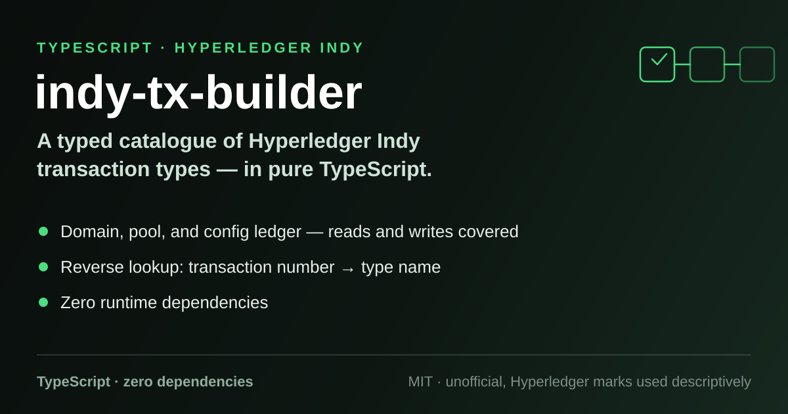

# indy-tx-builder

<p align="center"></p>

**An unofficial, dependency-free TypeScript toolkit for working with
[Hyperledger Indy](https://www.hyperledger.org/projects/hyperledger-indy) ledger transactions.**

A **pure TypeScript** library that maps the Hyperledger Indy node transaction
catalogue — write transactions across the **domain**, **pool**, and **config**
ledgers, plus the read (`GET_*`) request types — to typed constants, with a
helper to resolve a raw numeric type code back to its human-readable name.

> ⚠️ **Unofficial.** This is a community project, **not affiliated with, endorsed
> by, or sponsored by** the Linux Foundation or the Hyperledger Foundation.
> "Hyperledger" and "Indy" are trademarks of the Linux Foundation, used here
> only descriptively to say what this library works with.

- **Pure TypeScript.** No runtime dependencies at all — `package.json` lists
  devDependencies only.
- **Typed transaction catalogue.** Every type code is an enum member, grouped
  the way Indy itself groups them: by ledger for writes, plus the read requests.
- **Reverse lookup.** Got a bare `"type": "105"` in a ledger reply? Ask the
  library and get `GET_NYM` back.

## Status

Early development (`0.1.0`), **not yet published to npm** — consume it from the
Git repository for now. The typed transaction catalogue and the reverse-lookup
helper are implemented; request **building and validation** on top of these
types is the roadmap.

## Usage

The package has a single default export with two members, `types` and `helpers`:

```ts
import indy from 'indy-tx-builder';

// Transaction type codes, grouped into Write and Read
indy.types.Write.NYM;         // '1'   — domain ledger
indy.types.Write.NODE;        // '0'   — pool ledger
indy.types.Write.POOL_CONFIG; // '111' — config ledger
indy.types.Read.GET_SCHEMA;   // '107'

// Reverse lookup: numeric code (number or string) -> transaction name
indy.helpers.getTypeByNumber(1);     // 'NYM'
indy.helpers.getTypeByNumber('107'); // 'GET_SCHEMA'

// Unknown codes throw:
indy.helpers.getTypeByNumber(999);   // Error: Transaction description not found.
```

The source also ships a `roles` enum (`src/roles.ts`) covering the Indy NYM
role codes — `TRUSTEE` (`'0'`), `STEWARD` (`'2'`), `ENDORSER` (`'101'`),
`NETWORK_MONITOR` (`'201'`), and `USER` — which is not yet part of the default
export.

## Supported transaction types

Everything below exists in the source today (`src/tx-types/`), with the numeric
code Indy uses on the wire.

### Write — domain ledger

| Type | Code |
| --- | --- |
| `NYM` | `1` |
| `ATTRIB` | `100` |
| `SCHEMA` | `101` |
| `CLAIM_DEF` | `102` |
| `REVOC_REG_DEF` | `113` |
| `REVOC_REG_ENTRY` | `114` |

### Write — pool ledger

| Type | Code |
| --- | --- |
| `NODE` | `0` |

### Write — config ledger

| Type | Code |
| --- | --- |
| `TRANSACTION_AUTHOR_AGREEMENT` | `4` |
| `TRANSACTION_AUTHOR_AGREEMENT_AML` | `5` |
| `TRANSACTION_AUTHOR_AGREEMENT_DISABLE` | `8` |
| `POOL_UPGRADE` | `109` |
| `NODE_UPGRADE` | `110` |
| `POOL_CONFIG` | `111` |
| `AUTH_RULE` | `120` |
| `AUTH_RULES` | `122` |

### Write — other

| Type | Code |
| --- | --- |
| `SET_CONTEXT` | `200` |

### Read requests

| Type | Code |
| --- | --- |
| `GET_TXN` | `3` |
| `GET_TXN_AUTHOR_AGREEMENT` | `6` |
| `GET_TXN_AUTHOR_AGREEMENT_AML` | `7` |
| `GET_ATTR` | `104` |
| `GET_NYM` | `105` |
| `GET_SCHEMA` | `107` |
| `GET_CLAIM_DEF` | `108` |
| `GET_REVOC_REG_DEF` | `115` |
| `GET_REVOC_REG` | `116` |
| `GET_REVOC_REG_DELTA` | `117` |
| `GET_AUTH_RULE` | `121` |
| `GET_CONTEXT` | `300` |

## Building from source

```bash
git clone https://github.com/eduelias/indy-tx-builder.git
cd indy-tx-builder
npm install
npm run build   # tsc -> dist/
```

See [`CONTRIBUTING.md`](CONTRIBUTING.md) if you want to help out.

## Trademarks

"Hyperledger" and "Indy" are trademarks of the Linux Foundation. This project
is **unofficial and community-maintained**; the marks are used only to describe
what the library interoperates with, and no affiliation or endorsement is
implied.

## License

Licensed under the [MIT License](LICENSE).
